==============
User Interface
==============

Terminology
===========
DCscope introduces several terms in the user interface that also play
a role in data analysis and are consequently used in the entire code base.

basin
    A source of feature data stored in datasets other than the one opened
    by the user. For an overview on basins, please take a look at the
    :ref:`dclab documentation <dclab:sec_av_basins>`. When exporting data
    from DCscope, the original dataset can be referenced via basins,
    allowing you to reduce data redundancy.

block matrix
    The :ref:`sec_block_matrix` is a visualization of the analysis
    pipeline. It is divided into data matrix (filters) and plot matrix (plots).

dataslot or slot
    A slot holds all information about a measurement: the path to the
    .rtdc file, fluorescence labels, display color, etc. (see the
    *Dataset* tab in the :ref:`sec_analysis_view`).

filter
    A filter is a set of filtering options (box filter, polygon filter,
    downsampling, etc.) that can be applied to a slot (see the
    *Filter* tab in the :ref:`sec_analysis_view`). Filters can be exported
    and imported again in DCscope (.sof file format).

filter ray
    A filter ray is a list of filters that can be applied to a slot.
    In DCscope, each row in the :ref:`sec_block_matrix` contains
    one filter ray.

pipeline
    A pipeline consists of all filters, slots, plots, and the filter rays
    (the filter selection) applied to each slot. A DCscope session file
    (.so2) stores all information necessary to rebuild a pipeline.

plot
    A plot is a user-defined visualization of a slot/filter ray combination.

Basic usage
===========
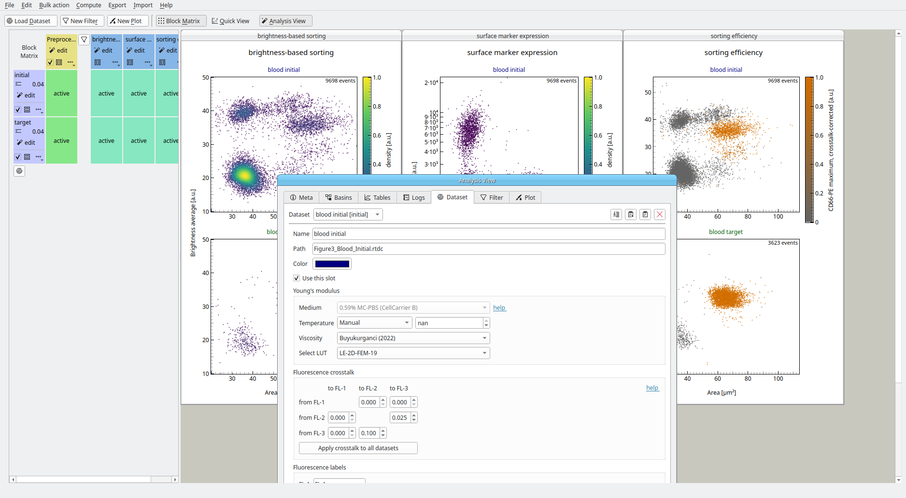

The user interface is split into several parts: the menu bar and the tool
bar at the top, the Block Matrix on the left, and the Workspace on the right
(example data taken from :cite:`NawUrb2019`, :cite:`NawUrb2019data`).

Menu bar and tool bar
---------------------
The menu bar is used for session management (File menu)
and makes additional functionalities available, such as batch
processing, data statistics, data export, plot export, or filter import/export.
The tool bar contains shortcuts for adding new datasets,
filters, or plots (left part) and allows you to hide/show the
:ref:`sec_block_matrix` as well as the :ref:`sec_quick_view` and
:ref:`sec_analysis_view` windows (right part).

To load datasets, use *File | Load dataset...* or the corresponding tool bar
button. Alternatively, you can drag and drop .rtdc files or directories
from your file manager onto the DCscope window. Directories are searched
recursively for .rtdc files.

.. _sec_block_matrix:

Block Matrix
------------
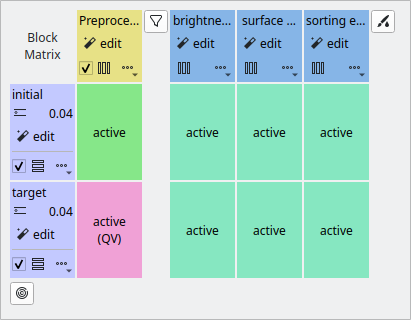

The Block Matrix gives an overview of the current analysis
pipeline. Each row represents a dataset (purple). The columns represent
either filters (yellow) or plots (blue) of your pipeline.
You can change the order of datasets via the *Edit|Change dataset order*
menu bar entry.

You can perform dataset operations in the purple rectangular area
at the beginning of each row: To modify a dataset, click on the *edit*
button. You can duplicate, insert anew (unmodified), or remove datasets
using the dropdown menu. You can also exclude a dataset from an analysis
via the check box.

Filters can also be modified, copied, removed and disabled.
By default, all filters are disabled when they are created. To apply a filter
to a dataset, click on the corresponding matrix element. The element changes
its color from gray (inactive) to green (active). In DCscope, all
filters that are applied to a dataset are called a **filter ray**.
In the above example, the filter ray only consists of a single filter for each
dataset. Filter rays may be different for each dataset. 

To activate or deactivate an entire row or column at once, use the
toggle buttons in the headers of the Block Matrix: The toggle button of
a dataset enables or disables all filters and plots for this dataset,
the toggle button of a filter activates or deactivates the filter for
all datasets, and the toggle button of a plot includes or excludes all
datasets in this plot.

By holding down the *Shift* key while clicking on a matrix element, you
can activate the :ref:`Quick View <sec_quick_view>` for the specific
dataset (with filters applied up until the selected column). The block matrix
element is then colored pink.

To add a plot, click on the *New Plot* button in the tool bar. This adds
a plot column with a blue header to the Block Matrix and creates an empty
plot window. You can add datasets to your plot by clicking on the
corresponding matrix elements. In the above example, both datasets are
being used in all three plots. 

The modification of datasets, filters, and plots is discussed below.

Workspace
---------
The Workspace is designed as an infinite scrollable area and contains all
plot windows as well as the :ref:`sec_quick_view` and Analysis View windows.

.. _sec_analysis_view:

Analysis View
-------------
The analysis view consists of seven tabs that allow you to inspect the
datasets loaded and to perform filtering and plotting actions.

Meta
....
The **Meta** tab displays all metadata of the selected dataset that
are stored in the original .rtdc file. Here you can check and compare
measurement and postprocessing parameters. The meaning of the
individual metadata keys is described in the
:ref:`dclab documentation <dclab:sec_experiment_meta>`.

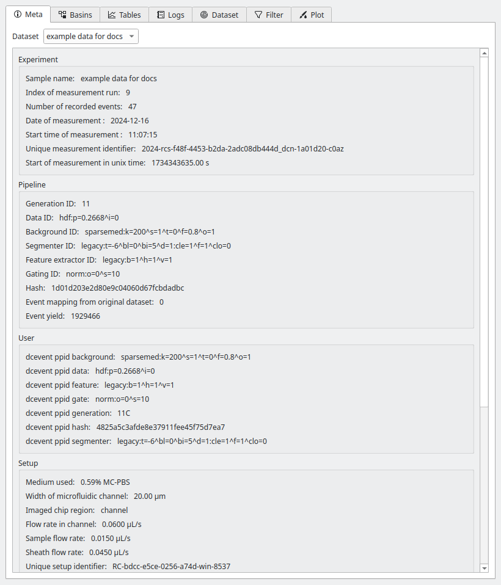

    Meta tab in the Analysis View.

Basins
......
The **Basins** tab yields insight into the basins that are loaded for
a dataset. Find out more about basins in the
:ref:`dclab documentation <dclab:sec_av_basins>`.

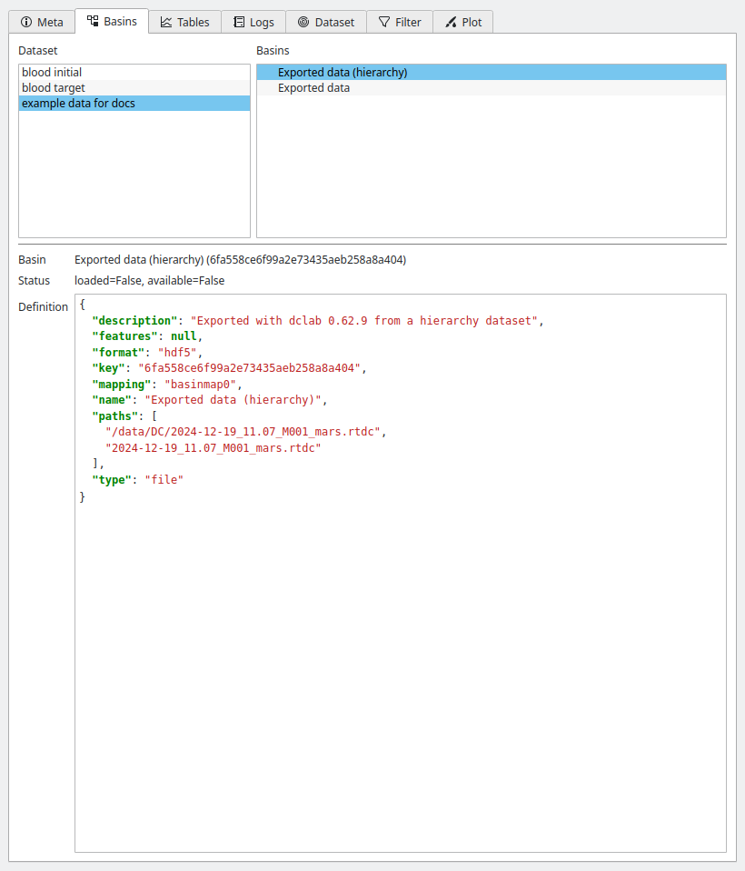

    Basins tab in the Analysis View.

Tables
......
The **Tables** tab allows you to visualize additional telemetry recorded
during the measurement (see :ref:`tables in dclab <dclab:sec_av_tables>`).
You can use it for quality control and to identify
reasons for temporal trends within a dataset.

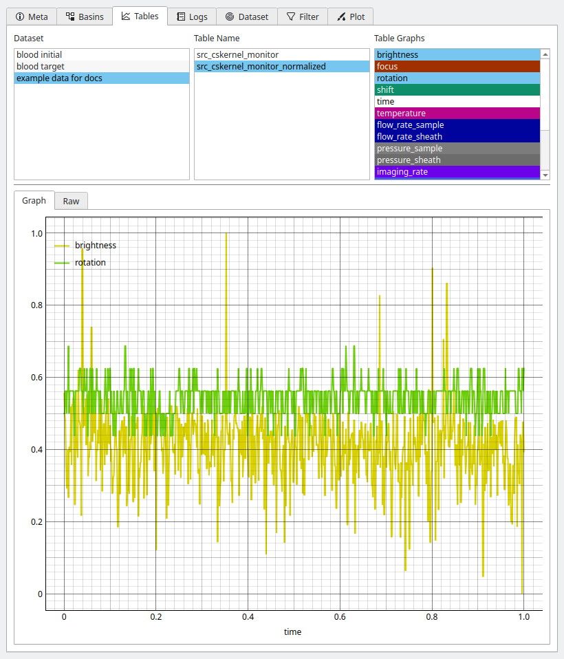

    Tables tab in the Analysis View.

Logs
....
The **Logs** tab gives access to all logs stored in a dataset.

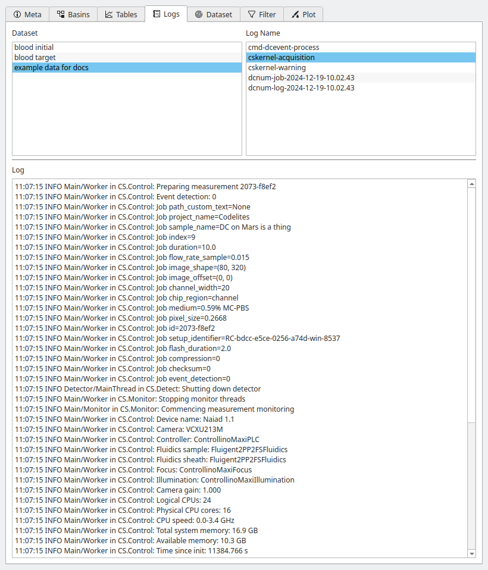

    Logs tab in the Analysis View.

Dataset
.......
The **Dataset** tab allows you to
specify additional metadata, such as unique colors used for plotting and
:ref:`analysis metadata <dclab:sec_analysis_meta>` for computing the
Young's modulus (see :ref:`sec_qg_youngs_modulus`) or correcting
for fluorescence crosstalk (see :ref:`sec_qg_fl_crosstalk`). With the
*Apply crosstalk to all datasets* button, you can use the crosstalk
coefficients of the current dataset for all datasets of the session.
The Dataset tab also allows you to specify fluorescence
channel labels that will then be used for labeling the axes of plots.

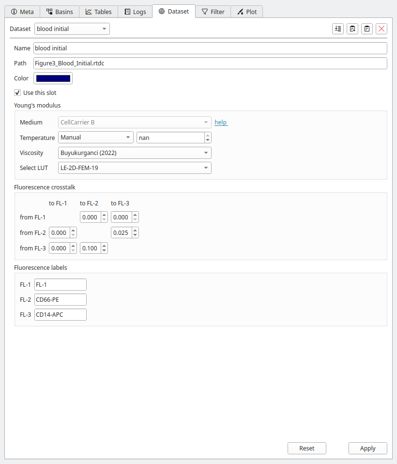

    Dataset tab in the Analysis View.

Filter
......
The **Filter** tab is used to modify the filters of the pipeline
(see also :ref:`filtering in dclab <dclab:sec_ref_rtdc_filter>`).
Besides box and polygon filters, a filter can limit the number of
events (*Limit number of events to*; surplus events are removed
randomly, but in a reproducible manner) and remove events that
are nan- or inf-valued for any feature (*Remove invalid events*).
New box filters can be added by selecting *Select box filters...*.
Polygon filters are created in the :ref:`sec_quick_view` window.
In the *Polygon filters* section of the Filter tab, you can also create
(*Create*) or modify (*Edit/View*) polygon filters (both open the
Quick View), duplicate them (*Duplicate*), or remove them (*Remove*).
For more information on polygon filters, please see the
:ref:`dclab documentation <dclab:sec_ref_polygon_filter>`.
Click *Apply* for any changes to take effect.

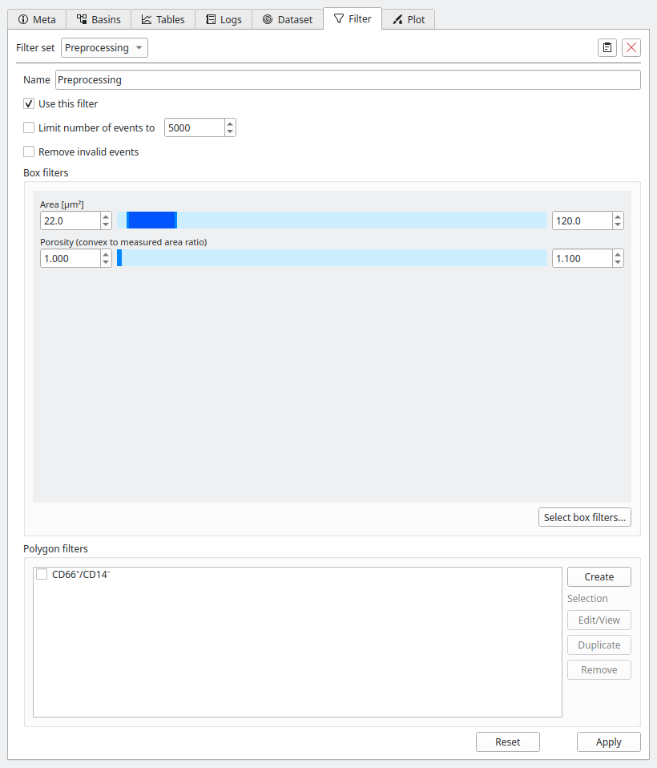

    Filter tab in the Analysis View.

Plot
....
The **Plot** tab allows you to specify all plotting parameters. Please
take special note of the *Division* option in the *Layout* section (defines
the arrangement of the subplots) and the *Marker hue* option in the
*Scatter plot* section (allows you to specify whether the scatter
data points are colored according to a
:ref:`kernel density estimate (KDE) <dclab:sec_av_scatter>`,
another feature dimension, or the dataset color specified in the
*Dataset* tab). In this example, contour plots are not used.

Further options in the *General* section include isoelasticity lines (for
which you can select the look-up table) and the KDE spacing used for the
contour plots, which you can determine automatically with *Find best
spacing*. If you check *default XY range* or *default KDE spacing*, the
plot range (minimum to maximum with a 5% margin) or the KDE spacing
(100 bins across the axis range) are reset when you click *Apply*.
To show only contour plots, uncheck the *Scatter plot* section. With
the *Zoom-in* option in the *Contour density plot* section, the plot
range is set to the region covered by the contours.

Use the *Save as default* button to use the current plot settings
(except for the plot name, the plot ranges, and the KDE spacing) for
all plots that you create in the future. You can reset these defaults
in the *General* tab of the :ref:`preferences <sec_preferences>`.
There, you can also set the default viscosity model and look-up table
that are used for computing the Young's modulus of new datasets.

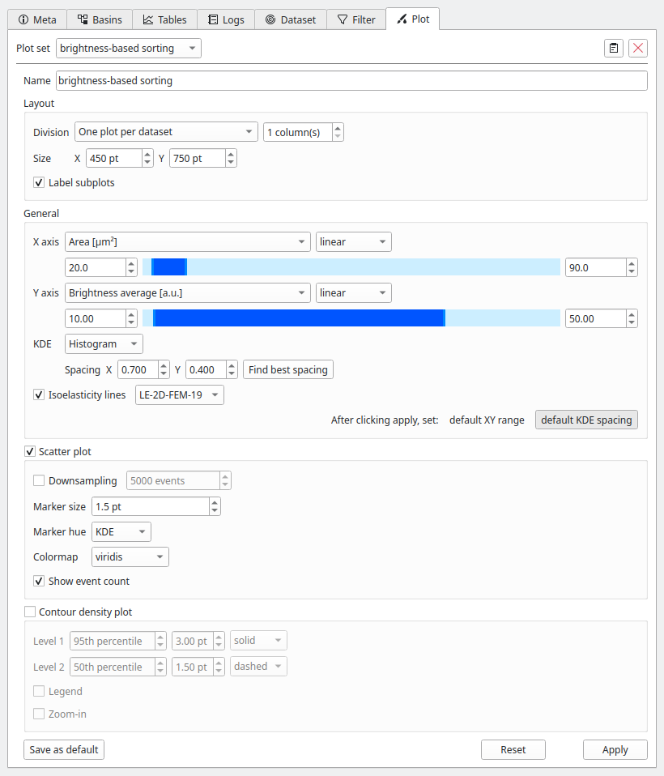

.. _sec_quick_view:

Quick View
----------
The Quick View is meant for dataset exploration. It consists of a scatter plot
on the left (left click for panning and right-click for zooming) and a set of
tool panels that are accessible via the corresponding tool buttons on the right.
The title of the Quick View window shows the name of the current dataset and
the position in the filter ray up to which the filters are applied (see
:ref:`sec_block_matrix`).

Use the **Plot** panel to define all plot parameters. It also displays
:ref:`common statistics <dclab:sec_ref_statistics>` of the two features
plotted. The drop down menus for the
`X` and `Y` axes list the available features for the current dataset. The
background color for each of the features is an indicator for the feature
availability:

- *green*: The feature data are present in the current dataset or are
  already computed.
- *blue*: The feature data are part of another dataset,
  a :ref:`basin <dclab:sec_av_basins>`, which may be at a remote location
  (e.g. on `DCOR <https://dcor.mpl.mpg.de/>`_) or on the local file system.
- *orange*: The feature data must be computed before it can be displayed. The
  feature is an :ref:`ancillary feature <dclab:sec_features_ancillary>`.

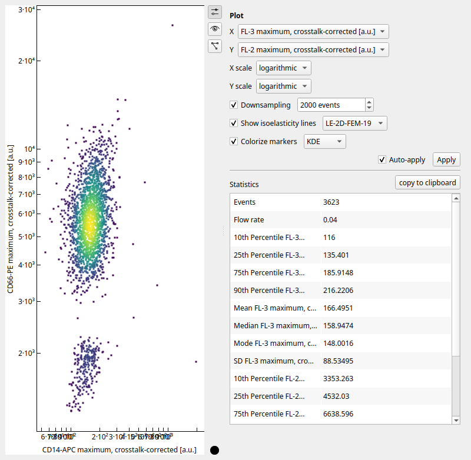

The **Event** panel displays all parameters of an individual event. You can
select single events by clicking in the scatter plot or by scrolling through
the *Index* spin control. If available, the event image is shown alongside the
fluorescence trace of the event. The options below the image allow you to
show the event contour (*Show contour*), to enhance the contrast (*Auto
contrast*), to zoom in to the event (*Zoom to event*), and, if the dataset
contains background images, to subtract the background (*Subtract
background*). The :ref:`fluorescence traces <dclab:sec_av_fltrace>` are
shown with the baseline offset (stored in the dataset metadata) added,
i.e. they show the signal from which e.g. the fluorescence maximum
is computed. If the legend of the fluorescence trace
plot covers parts of the traces, you can move it by dragging it with the
mouse. The checkboxes above the trace plot allow you to hide the raw traces
or the traces of individual fluorescence channels. All features of the
event are listed in a separate tab.

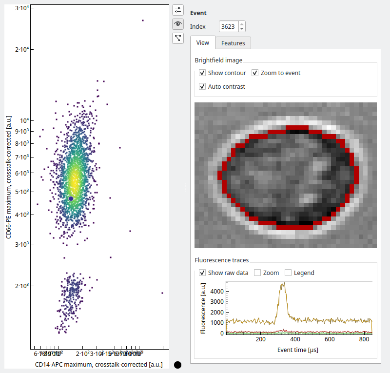

The **Polygon Filter** panel allows you to create and modify polygon filters.
When the panel is active you can move the mouse pointer across the scatter
plot and the image of the event closest to the mouse pointer is displayed.

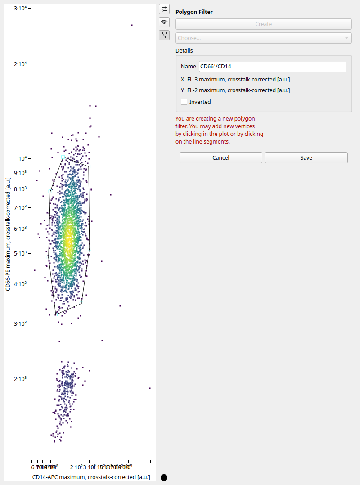

.. _sec_preferences:

Preferences
-----------
The preferences dialog (*Edit | Preferences*) is organized in several tabs.
Click *Apply* or *OK* to store your changes. *Restore Defaults* resets
all settings to their default values.

General
    Choose whether DCscope should check for updates on startup and set the
    width of the dataset tiles in the :ref:`sec_block_matrix`. In the
    *Defaults for new plots and datasets* section, you can see whether new
    plots use the built-in plot settings or the user-defined settings that
    you stored with the *Save as default* button in the *Plot* tab of the
    :ref:`sec_analysis_view` (*Reset* restores the built-in plot settings).
    You can also set the viscosity model and the look-up table that are
    used by default for computing the Young's modulus of new datasets
    (see :ref:`sec_qg_youngs_modulus`).

DCOR
    Set the DCOR server, your personal API key for accessing private data,
    or load an encrypted DCOR access token (see :ref:`sec_qg_dcor`).

S3 basins
    Specify the access credentials (endpoint URL, access key ID, and secret
    access key) for datasets with basins in an S3 object store
    (see :ref:`sec_qg_dcor_s3`). You have to restart DCscope for these
    settings to take effect.

R/lme4
    Set the path to the R executable and install the lme4 R package
    required for statistical significance testing (see :ref:`sec_qg_lme4`).

Extensions
    Load and manage extensions (see :ref:`sec_qg_extensions`).

Advanced
    The *Developer mode* activates unusual options, such as allowing
    unencrypted connections to DCOR, visualizing basinmap features, or
    advanced plot export options. The *Caching* section lets you configure
    how many computed values (e.g. kernel density estimates) are kept
    in memory and how much disk space DCscope may use for caching
    computed values persistently. You can also change the location of
    the disk cache or clear it. Changes in this tab require a restart of
    DCscope.
