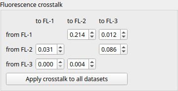

.. _sec_qg_fl_crosstalk:

======================
Fluorescence crosstalk
======================
The emission spectra of fluorescent dyes are broad. Therefore, a dye
that is detected in one fluorescence channel (e.g. FL-1) usually also
contributes to the signal of other channels (e.g. FL-2). With DCscope,
you can correct the maximum fluorescence signals for this crosstalk
(also called spillover or bleed-through).

The theory and the computation are described in more detail in the
:ref:`dclab docs <dclab:sec_av_fl_crosstalk>`.

Crosstalk coefficients
----------------------
The crosstalk coefficient from channel *i* to channel *j* is the fraction
of the signal of a dye detected in channel *i* that is additionally
detected in channel *j*. The coefficients depend on the dyes, the optical
filters, and the detector settings. You have to determine them with control
samples that are stained with only one dye (single-stained controls),
measured with the same setup and settings as the actual sample:

1. Load the control sample stained with the dye of channel *i* and
   (optionally) an unstained control sample.
2. Select the stained population with a filter
   (see :ref:`sec_qg_filtering`) and determine the median of
   *FL-i maximum* and *FL-j maximum*, e.g. with the *Statistics* tool
   in the *Compute* menu (see :ref:`sec_qg_batch_stats`).
3. The crosstalk coefficient from channel *i* to channel *j* is the
   ratio of the medians, i.e. *FL-j maximum* divided by
   *FL-i maximum*. If unstained cells already yield a signal (offset)
   in these channels, subtract it from both medians before computing
   the ratio.

Repeat this for every pair of channels and dyes used in your measurement.

Setting the crosstalk coefficients
----------------------------------
.. _qg_fl_crosstalk_matrix:

    Crosstalk coefficients for a dataset with three fluorescence channels.

The crosstalk coefficients are set in the *Fluorescence crosstalk* section
of the *Dataset* tab in the :ref:`Analysis View <sec_analysis_view>`
(:numref:`qg_fl_crosstalk_matrix`). Each row contains the crosstalk *from*
one channel *to* the other channels. For instance, in
:numref:`qg_fl_crosstalk_matrix`, 21.4 % of the signal in FL-1 is
additionally detected in FL-2. Only the coefficients between the
fluorescence channels of the dataset are shown. Click *Apply* to apply
the coefficients to the dataset. The coefficients are set for each dataset
individually. To use the same coefficients for all datasets of the session
(e.g. measured with the same setup), click *Apply crosstalk to all datasets*.

As soon as any of the coefficients is set (not zero), the crosstalk-corrected
features *FL-1 maximum, crosstalk-corrected* (fl1_max_ctc),
*FL-2 maximum, crosstalk-corrected* (fl2_max_ctc), and
*FL-3 maximum, crosstalk-corrected* (fl3_max_ctc) become available. Select
them as plot axes in the *Plot* tab or use them for filtering. The original
features (e.g. *FL-1 maximum*) are not modified.

To check the coefficients, apply them to the single-stained controls:
After the correction, the population stained with the dye of channel *i*
should have the same signal in channel *j* as unstained cells.

Negative values and logarithmic axes
------------------------------------
The correction subtracts the crosstalk from the measured signal. Because
of measurement noise, the corrected signal of events that are negative for
a dye is distributed around zero, i.e. some corrected values are negative.
This is expected: For correct coefficients, a population that is negative
for a dye should be centered around the signal of unstained cells.

Events with negative (or zero) values cannot be shown on a logarithmic
axis. If you choose *logarithmic* as the scale of a plot axis in the
*Plot* tab, these events are not displayed. Note that the event count shown
in the scatter plot still includes these events, i.e. you see fewer
events than the label says. Use linear axes to see all events, or check
whether a population is cut off at zero before drawing conclusions
from logarithmic plots.
